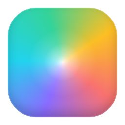
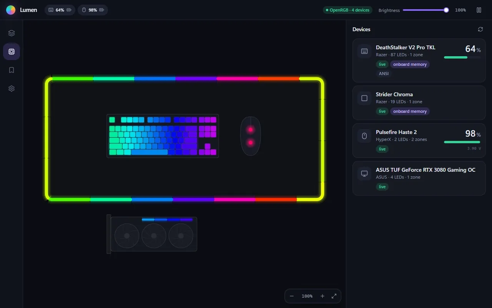
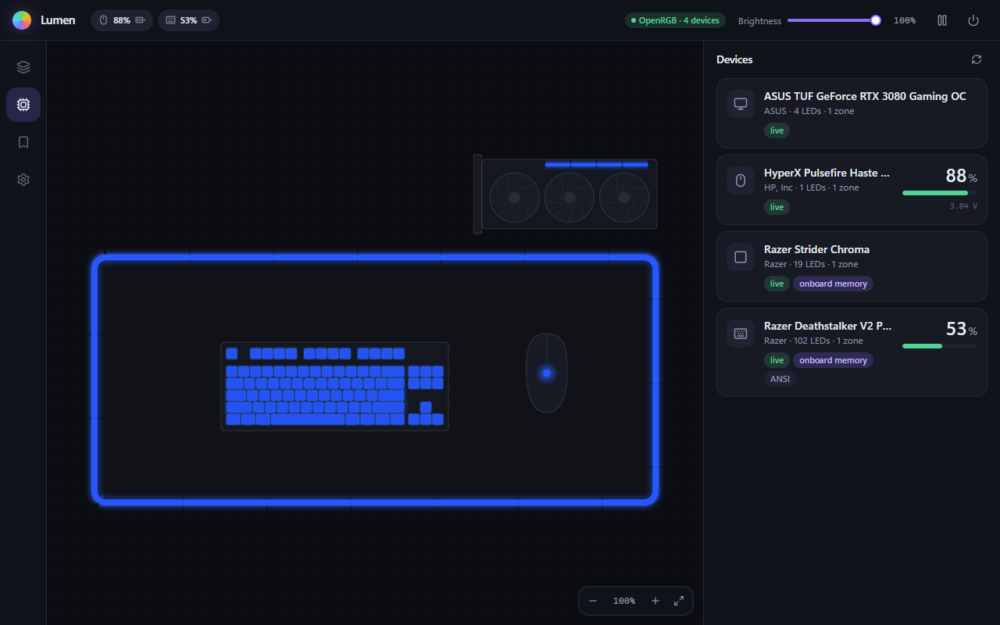
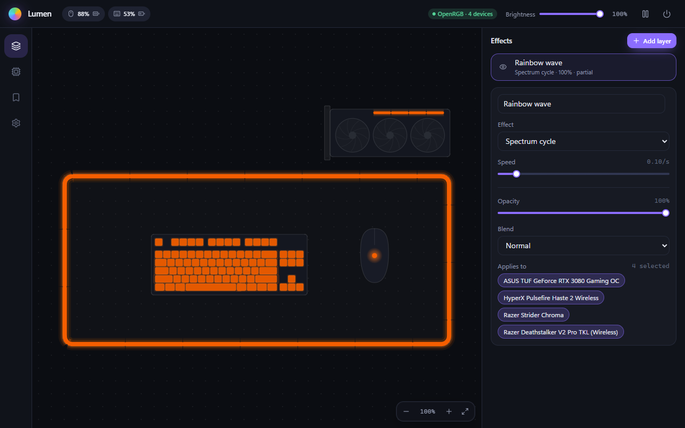
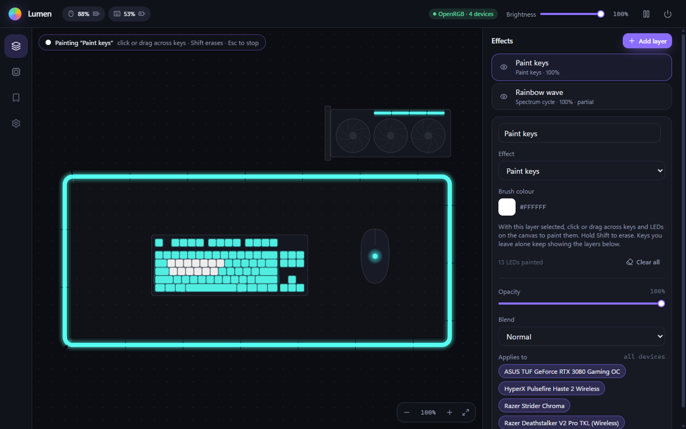
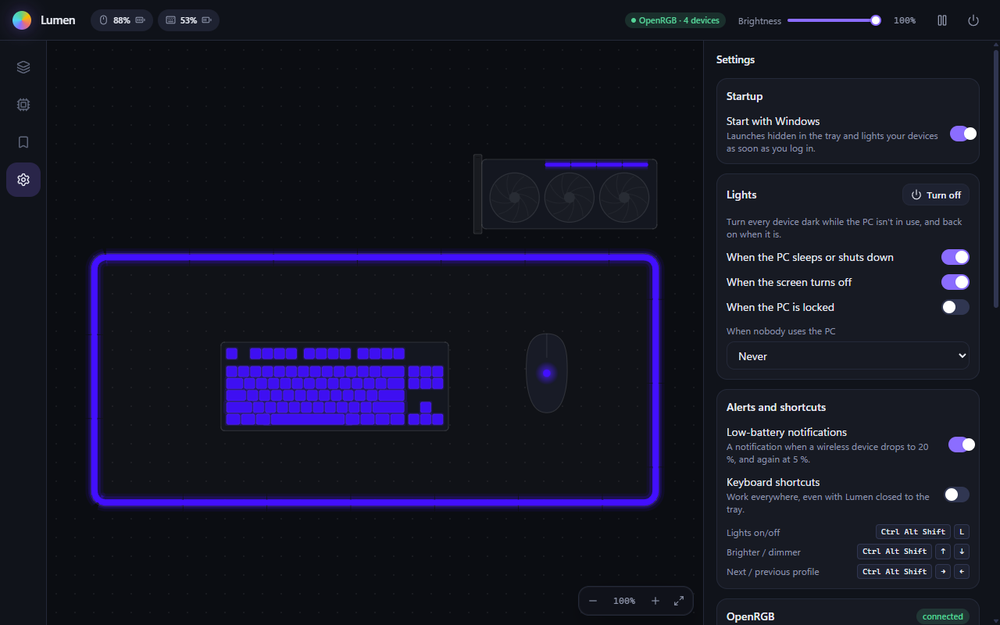

# Lumen

**One app for all your RGB gear, whatever the brand.**

[**Download**](https://github.com/rahmidaniel/lumen/releases/latest) ·
[Supported devices](#supported-devices) ·
[FAQ](#faq) ·
[Changelog](CHANGELOG.md) ·
[Contributing](CONTRIBUTING.md)

Razer has Synapse, Logitech has G HUB, Corsair has iCUE, SteelSeries has GG, ASUS has
Armoury Crate, HyperX has NGENUITY, Glorious has CORE. Each one is a separate download,
a separate background service, and a separate idea of what "sync" means. Lumen replaces
the lot with a single small, cross-platform app: one canvas where every device lights up
together, and one place to see battery levels and manage devices.

## What it does

- **Unified lighting.** Every device sits on one virtual desk, drawn to scale: keyboards on
  their real ANSI or ISO layout, mats as edge-lit loops, mice, graphics cards. A layer stack
  of effects (static, gradient, spectrum, wave, breathing, starlight) runs across all of them
  as one motion, in the spirit of Razer Chroma Studio, but for every brand at once.
- **Per-key painting.** A paint layer colours individual keys and LEDs on top of any effect.
- **Battery at a glance.** Wireless mice and keyboards show their charge on the Devices home,
  in the top bar and in the tray tooltip, and you get a notification at 20 % and 5 %.
- **Lights that follow your PC.** Everything goes dark when the PC sleeps, shuts down or
  turns its screen off, and, if you like, when it locks or sits idle; it comes back when
  you do. A lights switch sits in the top bar, the tray and an optional shortcut. (Windows
  for now.)
- **Boot lighting.** Where the hardware has onboard memory (Razer so far), Lumen writes the
  effect the device shows before any software has started.
- **Profiles** for saving and switching whole scenes, from the app, the tray menu or the
  keyboard.
- **Knows when another app is in the way.** If Synapse, G HUB, iCUE, Armoury Crate or
  another lighting app is running, Lumen says so and how to get it out of the way.
- **Light footprint.** Lives in the tray; closing the window frees the UI entirely while
  lighting keeps running, at about 30 MB of memory and 2 % of one CPU core. Starts with
  your OS if you want it to.
- **Self-contained and self-updating.** Installers bundle everything needed, and Lumen
  updates itself from GitHub Releases.

## Install

Download the package for your system from the
[latest release](https://github.com/rahmidaniel/lumen/releases/latest). Every package
bundles OpenRGB, so there is nothing else to install. The builds are not code-signed yet,
hence the one-time warnings below.

| System | Download | Notes |
|---|---|---|
| Windows 10/11 (x64) | `Lumen_<version>_x64-setup.exe` | Installs for your user, no admin rights needed. SmartScreen warns about an unknown publisher: **More info → Run anyway**. |
| macOS 11+ (Apple Silicon) | `Lumen_<version>_aarch64.dmg` | Drag Lumen to Applications, then run `xattr -cr /Applications/Lumen.app` once (Gatekeeper blocks unsigned apps). Grant *Input Monitoring* when macOS asks, so OpenRGB can reach keyboards. |
| macOS 11+ (Intel) | `Lumen_<version>_x64.dmg` | As above. |
| Debian, Ubuntu | `Lumen_<version>_amd64.deb` | Installs OpenRGB's udev rules, so devices work without root. |
| Fedora, openSUSE | `Lumen-<version>-1.x86_64.rpm` | As above. |
| Other Linux | `Lumen_<version>_amd64.AppImage` | Can't install udev rules: install `openrgb` from your distro (its rules suffice) or copy OpenRGB's `60-openrgb.rules` to `/etc/udev/rules.d/`. |

Lumen lives in the tray: close the window and lighting keeps running; *Start at login* in
Settings launches it hidden. Updates arrive through Settings → Updates.

> [!NOTE]
> Lumen is young (0.x). It is developed and tested on Windows 11 with Razer, HyperX and
> ASUS hardware; the macOS and Linux builds and the battery readers marked untested below
> still need reports from real machines. [Tell us how it goes](https://github.com/rahmidaniel/lumen/issues/new?template=device_report.yml).

## Supported devices

Lighting goes through [OpenRGB](https://openrgb.org), which Lumen bundles and manages for
you, so any device OpenRGB supports works: thousands of keyboards, mice, mats, headsets,
graphics cards, motherboards, RAM, fans and LED strips across Razer, Logitech, Corsair,
SteelSeries, ASUS, MSI, Gigabyte, HyperX, NZXT, Cooler Master and many more. See OpenRGB's
[supported devices list](https://openrgb.org/devices.html).

Things OpenRGB does not do, Lumen does itself, per vendor:

| Brand | Battery | Onboard boot lighting | Status |
|---|---|---|---|
| Razer | ✅ | ✅ | tested on hardware |
| HyperX | ✅ | – | tested on hardware |
| Logitech (HID++, Lightspeed/Unifying) | ✅ | – | from published protocol, untested |
| Corsair (Bragi and legacy wireless) | ✅ | – | from published protocol, untested |
| SteelSeries (Aerox, Prime, Rival) | ✅ | – | from published protocol, untested |
| ASUS ROG wireless mice | ✅ | – | from published protocol, untested |
| Glorious (CORE wireless) | ✅ | – | from published protocol, untested |

If you own one of the untested devices, a
[device report](https://github.com/rahmidaniel/lumen/issues/new?template=device_report.yml)
of what Lumen shows is very welcome.

## Screenshots

From the Windows build on real hardware. (The animation at the top is the browser build
of the same UI, running on simulated devices.)

**Devices home.** Every device OpenRGB reports, drawn to scale on one desk: the keyboard
on its real ANSI/ISO layout, the mat as an edge-lit loop, the mouse, the graphics card.
Battery gauges (with cell voltage where the mouse reports it) sit next to the devices that
have one, and selecting a Razer device offers its onboard boot lighting.

**Effects.** A layer stack: static colours, gradients, spectrum cycles, waves, breathing
and starlight, each with opacity, blend mode and the devices it applies to. One wave
travels across the mat, keyboard, mouse and GPU as a single motion.

**Paint keys.** A paint layer colours individual keys and LEDs: click or drag across the
canvas, Shift to erase. Keys you leave alone keep showing the layers below.

**Settings.** Start at login, how Lumen runs OpenRGB, the render rate, and updates.

## FAQ

<b>Can I uninstall Synapse, G HUB, iCUE and the rest?</b>

For lighting and battery levels, yes. Lumen does not yet configure DPI, buttons, macros
or firmware, so keep a vendor app around if you need those, but quit it (and stop it
starting with your PC) while Lumen runs: two programs driving the same LEDs make them
flicker between both.

<b>A device doesn't show up</b>

1. Check that OpenRGB supports it: [device list](https://openrgb.org/devices.html).
2. Quit the vendor app; some hold on to the device while they run. Lumen shows a warning
   in the top bar when it sees one running.
3. Graphics cards, motherboards and RAM need administrator access. On Windows, use
   Settings → OpenRGB → *Let Lumen manage OpenRGB* (one admin prompt). On Linux, check
   the udev rules (see [Install](#install)); on macOS, the *Input Monitoring* permission.
4. Settings → OpenRGB → *Rescan devices*.

If OpenRGB itself can't see the device, it's a request for the
[OpenRGB project](https://codeberg.org/OpenRGB/OpenRGB/issues). If it shows up but looks
or behaves wrong in Lumen, [open an issue here](https://github.com/rahmidaniel/lumen/issues/new/choose).

<b>Why does "Let Lumen manage OpenRGB" ask for administrator rights?</b>

Motherboard and RAM lighting only work when OpenRGB runs with administrator rights, and
OpenRGB's own Windows installer runs it as a service that Lumen can't control and that
keeps running after Lumen quits. Managing it asks once: it copies Lumen's OpenRGB to
`Program Files` (where only administrators can change it), installs a small service that
runs it, and disables OpenRGB's own service. From then on Lumen starts and stops OpenRGB
with itself, without prompts. *Stop managing* (or *Hand back to the service*) undoes it.
Details: [docs/openrgb.md](docs/openrgb.md).

If you used Lumen 0.2's version of this (a scheduled task), Lumen shows **Security fix
needed**: that task let other programs on the PC get administrator rights. One click in
Settings → OpenRGB switches to the service and removes it.

<b>How do I report a problem?</b>

Settings → Help → *Copy diagnostics* puts your Lumen and OpenRGB versions, setup, devices
and recent logs (no serial numbers) on the clipboard; paste it into a
[bug report](https://github.com/rahmidaniel/lumen/issues/new?template=bug_report.yml).
Lumen's logs live in `%LOCALAPPDATA%\dev.lumen.studio\logs` on Windows (*Open log folder*
in the same place).

<b>Where are my settings and profiles stored?</b>

In Lumen's data folder: `%APPDATA%\dev.lumen.studio` on Windows,
`~/Library/Application Support/dev.lumen.studio` on macOS and
`~/.local/share/dev.lumen.studio` on Linux. Profiles are JSON files in `profiles/`.

<b>Does Lumen send anything over the internet?</b>

Only the update check, which asks GitHub Releases whether a newer version exists (once a
day, switchable off in Settings → Updates). Device traffic stays on your machine: Lumen
talks to OpenRGB on `127.0.0.1:6742`. There is no telemetry.

<b>How do updates work?</b>

Settings → Updates checks on demand, and once a day in the background unless you switch
that off. Nothing is installed until you press *Install and restart*, and every update is
signature-checked before it runs.

## How it works

- **OpenRGB** does device I/O (headless SDK server, protocol v6). Lumen ships it, starts it,
  restarts it if it hangs, and stops it on exit ([details](docs/openrgb.md)).
- **Lumen** does everything else: the canvas, the effect engine (60 fps in Rust), profiles,
  vendor battery and onboard-memory sidecars, and the UI.

Built with Tauri 2, Rust, React 19, TypeScript and Tailwind. See
[`docs/PLAN.md`](docs/PLAN.md) for the architecture and milestones and
[`docs/protocols.md`](docs/protocols.md) for the vendor protocols Lumen speaks.

## Contributing

Device reports, bug reports and code are all welcome. [`CONTRIBUTING.md`](CONTRIBUTING.md)
covers building from source, the mock backend for UI work without hardware, and how to
add a vendor sidecar; [`docs/releasing.md`](docs/releasing.md) covers releases.

## License

Lumen is [MIT-licensed](LICENSE). Its installers also contain an unmodified copy of
OpenRGB, which is GPL-2.0-or-later; see [`THIRD_PARTY_NOTICES.md`](THIRD_PARTY_NOTICES.md).
